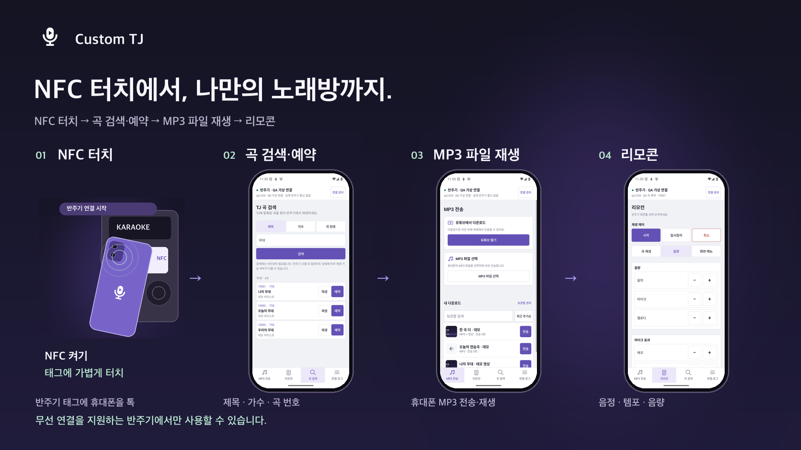

# Custom TJ

스마트폰으로 TJ 반주기에 연결해 곡을 검색하고, 리모컨을 조작하고, MP3를 전송하는 Android 앱입니다.

## 다운로드

[최신 APK 다운로드](https://github.com/drowsy-probius/custom-tj-release/releases/latest)

Android 8.0 이상을 지원합니다. 일반적인 최신 휴대폰은 `arm64-v8a`, 기종을 잘 모르겠다면 `universal` APK를 선택하세요.

## 사용

**무선 연결을 지원하는 반주기에서만 사용할 수 있습니다.**

- NFC 또는 Wi-Fi로 반주기에 연결합니다.
- MP3를 선택해 전송하거나 TJ 등록곡을 검색해 재생합니다.
- 유튜브 음원·영상을 내려받고 반주와 함께 영상을 재생할 수 있습니다.
- 새 버전은 앱의 **앱 업데이트**에서 확인합니다.

오픈소스 고지는 앱 안에서 확인할 수 있습니다.

## 기능 소개

https://github.com/user-attachments/assets/7a44b52b-93b8-488a-b692-690153402b1e

[영상 다운로드](docs/demo/custom-tj-promo-1080p.mp4) · [흐름 이미지](docs/demo/custom-tj-flow.png) · [주요 기능별 스틸샷 9장](docs/demo/README.md)

