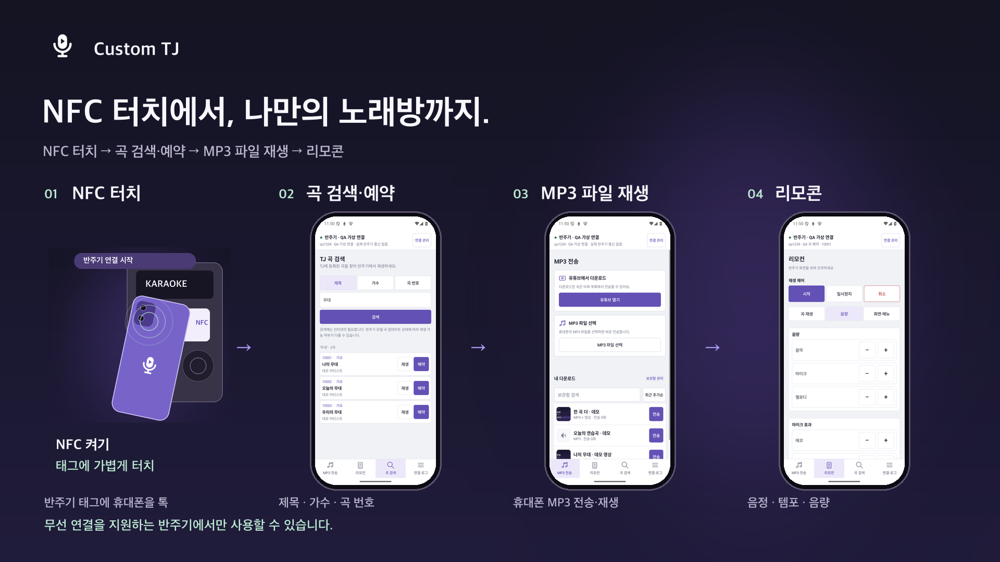
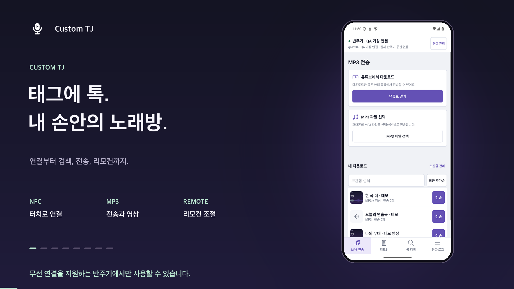
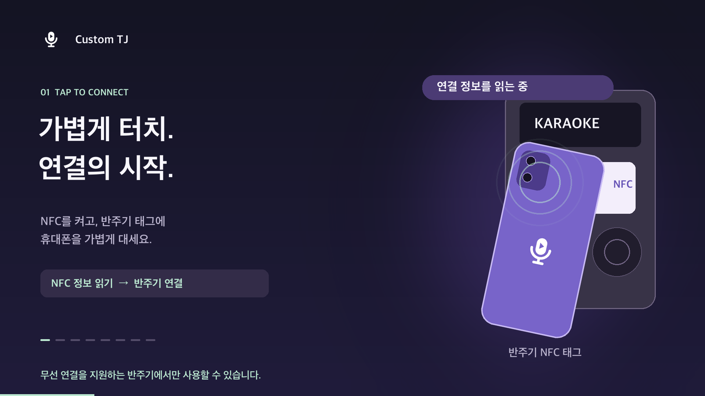
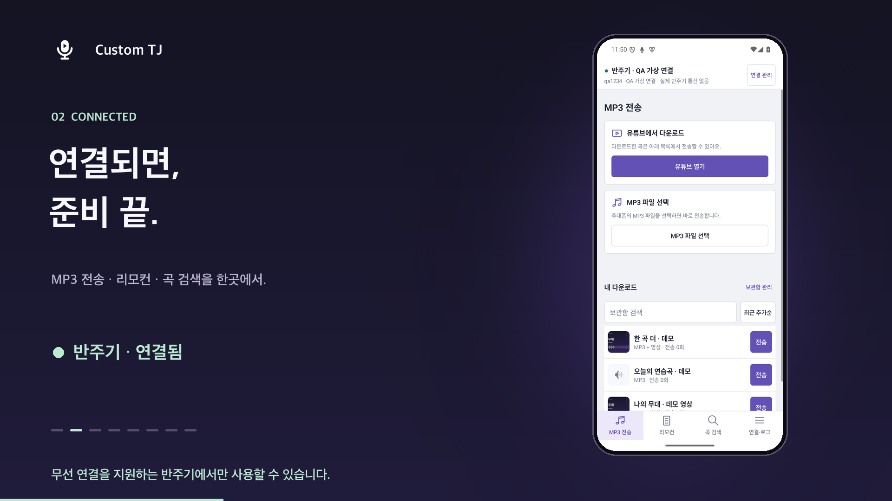
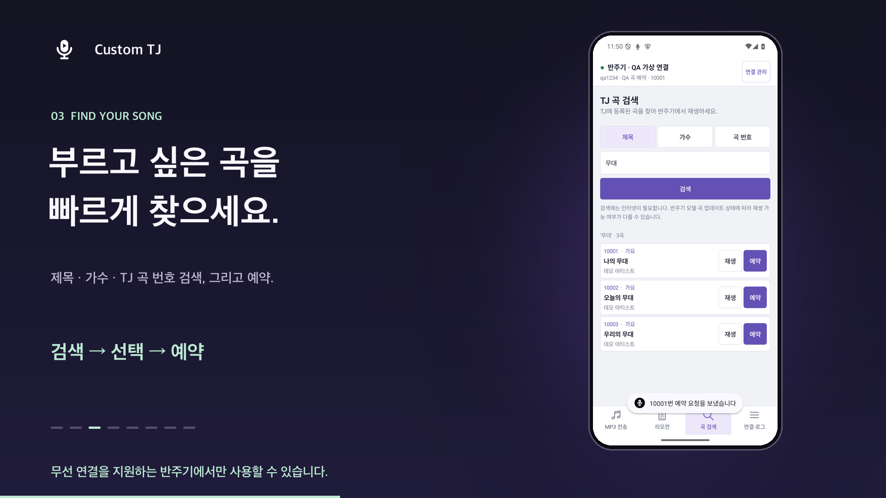
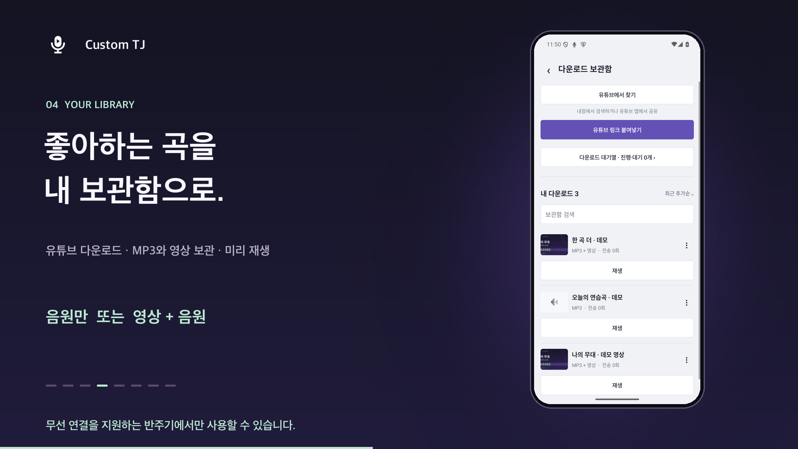
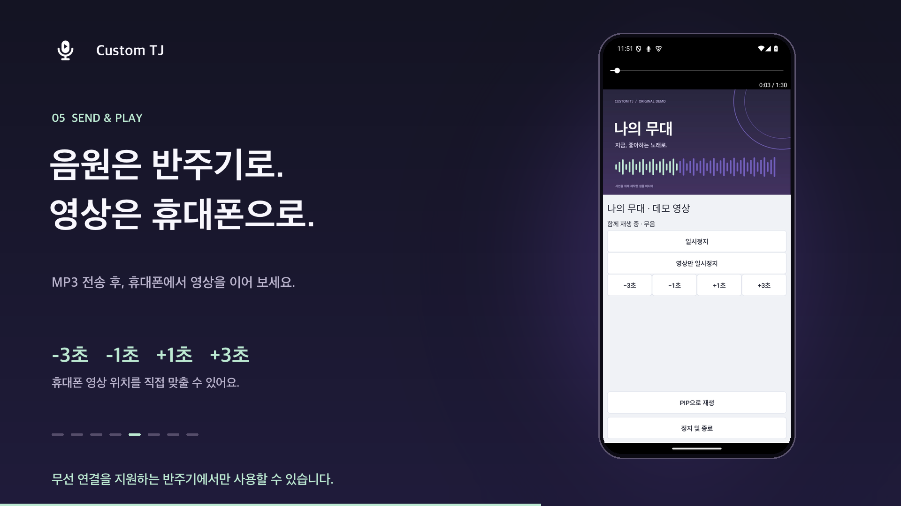
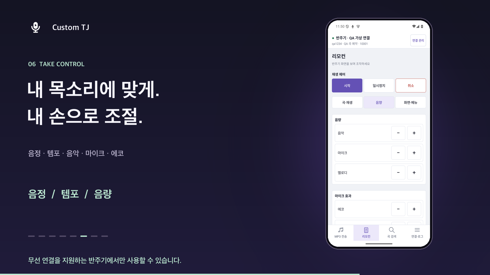
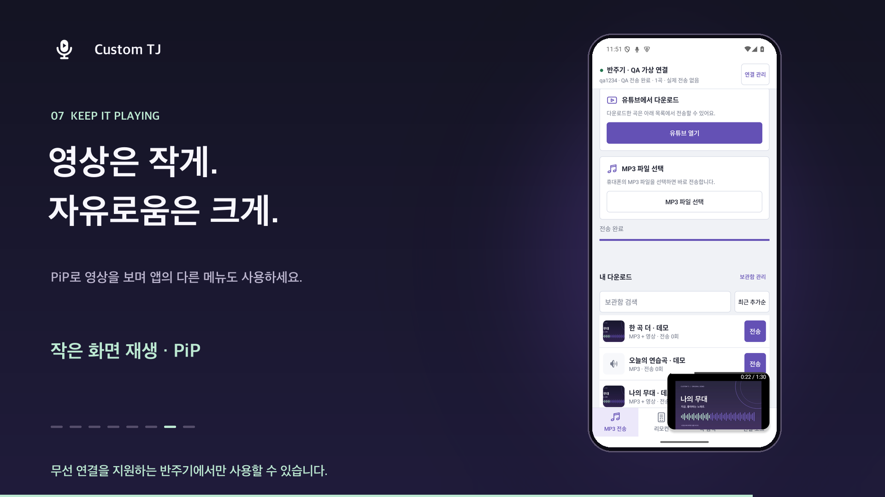
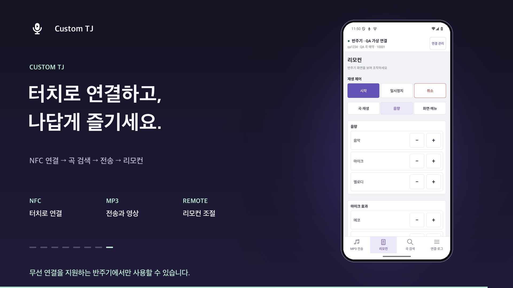

# Custom TJ 기능 소개

**무선 연결을 지원하는 반주기에서만 사용할 수 있습니다.**

## 60초 소개 영상

https://github.com/user-attachments/assets/7a44b52b-93b8-488a-b692-690153402b1e

[영상 다운로드](custom-tj-promo-1080p.mp4) · [한국어 설명 자막](custom-tj-promo.ko.srt)

## 한눈에 보는 흐름

**① NFC 터치 → ② 곡 검색·예약 → ③ MP3 파일 재생 → ④ 리모콘**

[흐름 이미지 원본](custom-tj-flow.png)

## 주요 기능별 스틸샷

| 소개 | NFC 터치 | 연결 완료 |
|---|---|---|
|  |  |  |

| 곡 검색·예약 | 다운로드 보관함 | MP3 전송·영상 |
|---|---|---|
|  |  |  |

| 리모컨 | 작은 화면 재생 | 마무리 |
|---|---|---|
|  |  |  |
